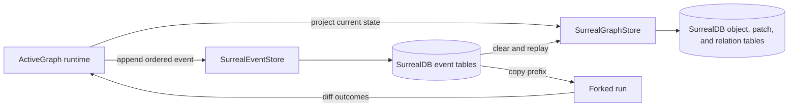

# activegraph-surrealdb

`activegraph-surrealdb` is a research-preview provider that explores using one
SurrealDB deployment for two distinct ActiveGraph responsibilities:

- an authoritative, append-ordered event log; and
- a queryable graph projection that can be erased and rebuilt from that log.

The important idea is not “put everything in one table.” It is “operate one
database without confusing the record of what happened with a disposable view
of what the world looks like now.”

## What is ActiveGraph?

[ActiveGraph](https://github.com/yoheinakajima/activegraph-packs) is a Python
framework for building agents on an event-sourced graph. A runtime appends
every decision and observation to an ordered event log, projects those events
into a graph of objects and relations, and runs queued behaviors until the
graph is idle. The event log is the authority; the graph is rebuildable state.
An optional pack library defines agent behaviors and fixtures on top.

This provider implements ActiveGraph's two store contracts — the `EventStore`
(append-ordered, hash-chained events with per-run heads, stale-writer
detection, and prefix forks) and the `GraphStore` (objects, patches, and
native `TYPE RELATION` edges) — on one SurrealDB deployment, with the query
hooks pushed down into SurrealQL. One database holds both the record of what
happened and the current view of the world, and the projection can always be
erased and replayed from events.

> **Status: research preview.** The repository uses contract-first development.
> Passing tests are evidence for the tested versions and failure paths only;
> they are not a production-readiness, high-availability, backup, performance,
> or security certification.

## Why a reactive, event-sourced graph?

A mutable graph is excellent for questions such as “what is connected to this
record now?” It is a poor audit trail by itself: replacing an object can erase
how the system reached that answer. An event log preserves the decisions and
inputs in order, but replaying the whole log for every query is expensive.

Keeping both gives a useful recovery and experimentation loop:

1. append facts and decisions to the event log;
2. project them into a graph for current-state queries;
3. copy a run prefix to fork an alternative decision;
4. diff the two outcomes; and
5. delete and replay a projection to prove it is derived state.

See [the experiment guide](docs/experiment.md) for the executable trace and the
limits of what it proves.

## Decision matrix

| Option | Durable events | Shared graph reads | Native graph edges | Operational shape | Fit here |
| --- | --- | --- | --- | --- | --- |
| SurrealDB over WebSocket with RocksDB | Provider goal | Provider goal | Yes | One single-node deployment in the qualified lane | Chosen research path |
| PostgreSQL plus a separate graph database | Mature event-store path | Yes | In the graph service | Two databases and a synchronization boundary | Strong alternative when operational maturity matters more than consolidation |
| SQLite plus an in-process graph | Local durable events | Process-local | No shared native graph | Very small | Development and upstream reproduction |
| Embedded SurrealDB or SurrealKV | Potentially | Potentially | Yes | In-process | Not qualified by this preview |

This project does not claim that SurrealDB is a universal replacement for
PostgreSQL or a distributed graph service. It evaluates a bounded provider
contract against a pinned, repeatable configuration.

## Supported research lane

| Component | Baseline |
| --- | --- |
| ActiveGraph | `1.12.0` |
| SurrealDB server | `3.2.4` stable |
| SurrealDB Python SDK | `2.0.0` |
| Python | `3.11+` |
| Transport | remote WebSocket; local qualification uses `ws://` |
| Storage engine | server-side RocksDB |

SurrealDB `3.3.x` prereleases are a non-gating preview lane. HTTP and embedded
engines are rejected by configuration (pinned by the embedded lane in
`tests/embedded/`). TLS has a demonstrated preview lane only — a local
certificate authority with enforced certificate validation; public CAs, proxy
termination, and rotation are unqualified. Details are in
[compatibility and known issues](docs/compatibility.md).

## Architecture at a glance



The two stores may share a namespace and database, but they do not share an
ActiveGraph-owned transaction. On ActiveGraph `1.12.0`, a runtime operation
persists its event before projecting it (CONTRACT v1.11 #2), so a rejected
append leaves no projected state. The projection is still a separate write: if
it fails after a successful append, replay is the documented repair path and the
provider does **not** claim atomic event-plus-projection acceptance.

## Taking advantage of one database

Because the event log and the graph projection share one deployment, the
provider pushes the released `GraphStore` query hooks down into SurrealQL rather
than scanning in Python. Object type filters, relation source/target/type
filters, existence probes, and the undirected neighbourhood walk are all bound
SurrealQL; `match_chain` composes those pushed-down primitives hop by hop. The
rich `where` predicate stays with ActiveGraph and is returned as an exact
residual, per the released contract. Schema v2 adds the indexes those queries
use; schema v3 records the object counter so reads return the reference store's
insertion order. See [ADR 0003](docs/adr/0003-native-query-pushdown.md) and
[ADR 0004](docs/adr/0004-projection-order.md).

## Pack library

The provider ships a harness that loads the published
[ActiveGraph pack library](https://github.com/yoheinakajima/activegraph-packs)
onto a `Runtime` whose event log and graph projection both live in SurrealDB:

```python
from activegraph_surrealdb import SurrealConfig, build_runtime

handle = build_runtime(
    SurrealConfig(
        endpoint="ws://127.0.0.1:8000",
        namespace="activegraph",
        database="assistant",
        username="root",
        password="root",
    ),
    run_id="run_1",
    scope="assistant",
)
handle.runtime.graph.add_object("source", {"kind": "note", "content": "..."})
handle.runtime.run_until_idle()
handle.close()
```

Point the harness at a checkout with `ACTIVEGRAPH_PACKS_PATH` (default: the
reference checkout). The `packs` test lane proves core, infrastructure,
communication (including composio), bridges, mcp, attention, evolution,
semantic_extraction, eval_outcome, activity_normalizer, connector_control,
skills, usage, and the importers all load and project into one SurrealDB
database.

A second lane runs each pack's own `fixtures/run_fixtures.py` unchanged on
SurrealDB-backed stores (`tests/packs/test_pack_fixtures_on_surrealdb.py`). All
but two suites pass; `communication` reads an object it created after a behavior
patched it, which only works with the in-memory object graph, and `evolution`
drives SQLite-backed subprocess forks. Both are recorded as expected divergences
rather than hidden.

Read the full [architecture](docs/architecture.md) and [security model](docs/security-model.md).

## Appropriate use cases

- auditable agent or workflow state where alternative decisions need comparison;
- reconciliation systems that need a current graph plus an ordered evidence log;
- identity or entity-resolution experiments with reviewable forks;
- derived relationship projections that must survive process restarts; and
- evaluating SurrealDB as a consolidated operational data plane.

Do not use this preview as the sole basis for a production system that requires
distributed high availability, proven backup/restore, unqualified transports,
or atomic writes across the event and projection stores.

Application contacts, identities, credentials, source documents, and CRM data
are outside this provider's schema. An application may choose the same
SurrealDB deployment for them, but it must design its own authorization,
retention, and migration boundaries.

## Quick start

Prerequisites: Python `3.11+`, Docker with Compose, and a local port `8000`.

```bash
cp .env.example .env
# Replace both example password values in .env with the same local-only value.
set -a
. ./.env
set +a

docker compose up -d
python -m venv .venv
. .venv/bin/activate
python -m pip install -e '.[dev]'
```

Run the contract layers separately:

```bash
pytest -m 'not surrealdb and not qualification and not embedded'
pytest -m surrealdb tests/integration
pytest -m packs tests/packs            # pack harness + per-pack fixture suites
python examples/replay_fork_diff.py
```

The qualification suite deliberately restarts and kills the named container.
Run it only against the disposable Compose service:

```bash
ACTIVEGRAPH_SURREALDB_QUALIFY=1 pytest -m qualification tests/qualification
```

See [deployment](docs/deployment.md) and [conformance](docs/conformance.md) before
interpreting a green result.

## Project map

- `src/activegraph_surrealdb/`: provider implementation
- `src/activegraph_surrealdb/harness.py`: load the pack library onto a SurrealDB Runtime
- `tests/`: unit, live integration, qualification, pack-harness and per-pack fixture, and upstream-known-issue contracts
- `examples/replay_fork_diff.py`: small fork/diff/replay experiment
- `examples/combined_store_pack.py`: a pack running on one SurrealDB event+graph store
- `docs/adr/`: authority, version, pushdown, and projection-order decisions
- `docs/`: architecture, operations, evidence, security, and provenance

## Contributing and security

Read [CONTRIBUTING.md](CONTRIBUTING.md) before proposing a change. Report
vulnerabilities through the private process in [SECURITY.md](SECURITY.md), not a
public issue.

## License

Copyright 2026 TrendpilotAI. Licensed under the [Apache License 2.0](LICENSE).
Dependency and trademark notes are recorded in [NOTICE](NOTICE).
